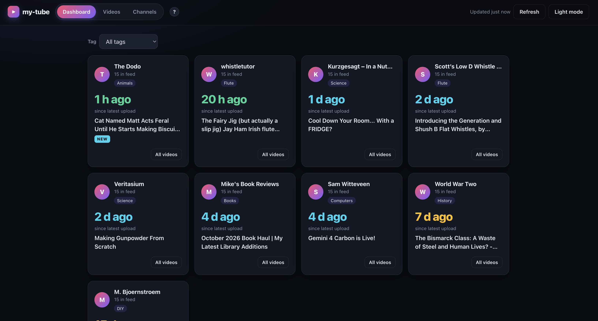
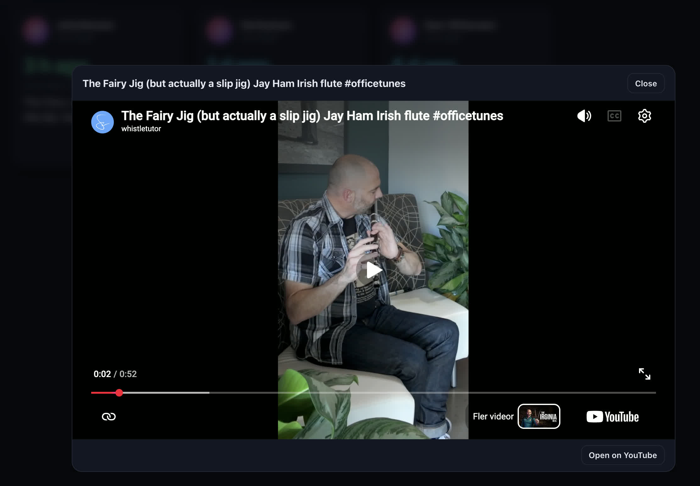
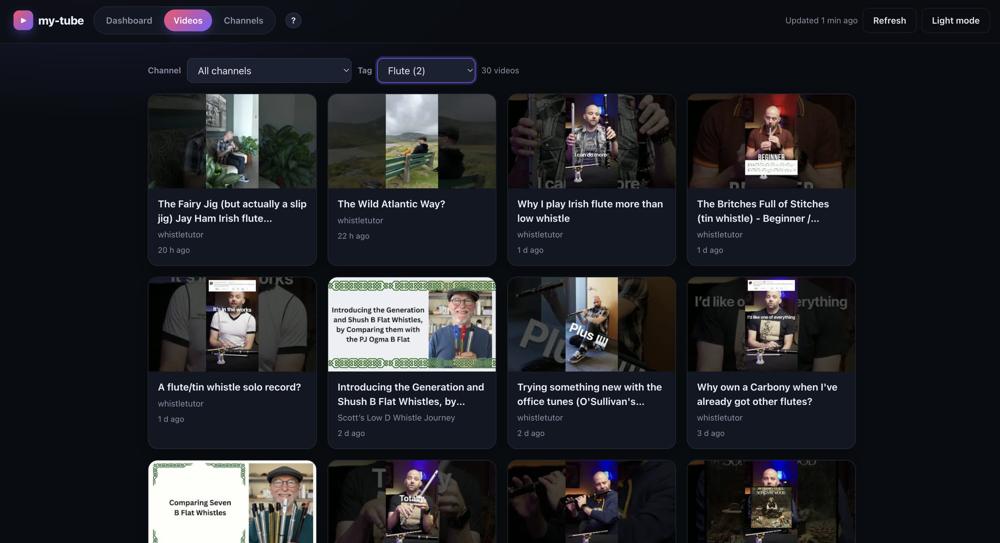
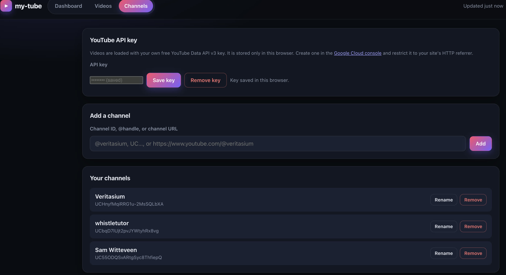

# my-tube

A personal dashboard for your favourite YouTube channels. It shows how long ago
each channel last uploaded, lists the latest videos in one feed, marks what is
new since your last visit, and plays videos in a pop-up.

It is a **static site**: no server and no database. It runs as one HTML file
that you can host on GitHub Pages. All your data stays in your browser.

You'll find it here: [https://etnt.github.io/my-tube/](https://etnt.github.io/my-tube/)

See also a demo [here](https://youtu.be/w4ZNnzd1mJo?si=9W2CvAS51cA5bd8q)

## Screenshots

<a href="screenshots/dashboard.jpeg"></a>
<a href="screenshots/popup.jpeg"></a>
<a href="screenshots/all_videos.jpeg"></a>
<a href="screenshots/channels.jpeg"></a>


## How it works

- **Data source:** the [YouTube Data API v3](https://developers.google.com/youtube/v3),
  called directly from your browser with your own API key. The API allows
  browser calls, so no proxy is needed.
- **Cost:** about 2 quota units per channel per refresh. The default daily
  quota is 10,000 units.
- **Storage:** your favourites, your API key, the theme, and the last-visit
  time are kept in the browser's `localStorage`. Nothing is sent anywhere
  except to YouTube's API.
- **Playback:** videos open in a dialog that uses YouTube's privacy-enhanced
  embed (`youtube-nocookie.com`).

## Set up your API key (once)

1. Open the [Google Cloud console](https://console.cloud.google.com/), create a
   project, and enable **YouTube Data API v3** under *APIs & Services → Library*.
2. Under *APIs & Services → Credentials*, choose **Create credentials → API key**.
3. Edit the key and set **Application restrictions → Websites**. Add
   `https://<your-user>.github.io/*`, for example `https://etnt.github.io/*`.
   The `/*` must be on the site origin, not on the project path such as
   `/my-tube/`: browsers send only the origin as the referrer on cross-origin
   requests, so a path-specific entry is rejected with a 403. For local
   testing, also add `http://localhost:5173/*`. Under **API restrictions**,
   allow only *YouTube Data API v3*.
4. In my-tube, open **Channels → YouTube API key**, paste the key, and save.

The key is stored only in your browser. Anyone who can see the page source can
see the key, so the referrer and API restrictions matter.

## Adding channels

Any of these work:

- a handle: `@veritasium` or `https://www.youtube.com/@veritasium`
- a channel ID: `UCBJycsmduvYEL83R_U4JriQ` or `https://www.youtube.com/channel/UC…`

Use **Rename** to give a channel a shorter label.

## Tags

In **Channels**, add one or more tags to a channel (comma-separated, for example
`Science, History`). A **Tag** dropdown on the Dashboard and Videos tabs shows only the
channels with that tag, for example all *Science* channels. Tags are stored in your
browser with the rest of your data and are not case-sensitive.

## Deploy to GitHub Pages

1. Push this repository to GitHub.
2. In the repository, open **Settings → Pages** and set **Source** to
   **GitHub Actions**.
3. Push to `main`. The workflow in `.github/workflows/pages.yml` runs the tests,
   builds the single-file app, and deploys it.

The build uses a relative base path, so the site works under any Pages path.

## Development

```sh
npm install
npm run dev        # http://localhost:5173
npm run build      # type-check, then build dist/index.html (single file)
npm test           # vitest run
```

## Project layout

- `src/youtube.ts`: YouTube Data API client and response parsing
- `src/dashboard.ts`: per-channel dashboard ordering
- `src/merge.ts`: merge, de-duplicate, and "new" markers for the video feed
- `src/storage.ts`: `localStorage` for favourites, API key, and last visit
- `src/channelId.ts`: channel ID and handle parsing
- `src/main.ts`, `index.html`, `src/style.css`: UI
- `src/feed.ts`, `server/`: the earlier RSS-proxy approach. It is no longer used
  by the app and is kept for reference (`npm run dev:server`, `npm start`).

## Limits

- Each channel shows its **15 most recent uploads**, which is a recent-activity
  view rather than an archive.
- Some videos cannot be embedded. Their player shows an error, and the dialog's
  **Open on YouTube** button works as a fallback.
- Clearing site data erases your favourites, API key, and last-visit marker.
  There is no sync between browsers or devices.
